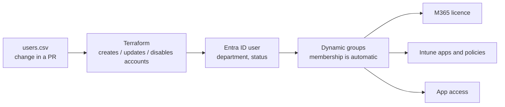

# Enterprise IT as Code

Running company IT the way engineering teams run software: changes live in Git, are
reviewed in a pull request, and a pipeline applies them. That gives IT that doesn't
depend on one person clicking the right things, and a change history that doubles
as audit evidence.

Built with standard tools: **Terraform, Entra ID dynamic groups, PowerShell and GitHub
Actions**.

| Module | Status |
| --- | --- |
| [`identity/`](identity/) Joiners, movers and leavers | **Working**, tested |
| Laptop provisioning (Autopilot / Apple Business Manager + Intune) | Design |
| Licence usage report | Next |
| Server baseline (Ansible) | Planned |

---

## Joiners, movers and leavers

The idea is small: **`users.csv` is the list of people. Dynamic groups do the rest.**



Terraform manages the accounts. Entra ID **dynamic groups** put each person in the right
groups from their department. Licences, Intune policies and app access are assigned to
those groups once. After that, nobody adds anyone to anything by hand.

| Event | Change in `users.csv` | What happens |
| --- | --- | --- |
| **Joiner** | Add a row with `status = pending` | Account created but disabled, so the laptop can be prepared before day one |
| **First day** | `pending` → `active` | Account enabled. Joins the department group, gets licence, apps and policies |
| **Mover** | Change `department` | Leaves the old department group, joins the new one automatically |
| **Leaver** | `active` → `leaver` | Account disabled. Drops out of every group, which frees the licence. Then run [`Remove-LeaverAccess.ps1`](scripts/Remove-LeaverAccess.ps1) to sign them out everywhere and wipe company data from their devices |

### Safety

- **Every change is a plan first.** A PR shows exactly what Terraform will do. Nothing
  changes until it's merged and a reviewer approves the apply.
- **Accounts are never deleted by accident.** Removing a row makes Terraform stop with an
  error (`prevent_destroy`). Leavers are disabled, not deleted.
- **Bad data is stopped early.** An unknown status or department fails the plan with a
  clear message.
- **Monitor first.** The offboarding script supports `-WhatIf` and refuses to touch an
  account that is still enabled. The pipeline only plans until it's switched on.
- **No secrets in the pipeline.** GitHub signs in to Entra with OIDC (workload identity
  federation).

### Try it without a tenant

```bash
cd identity
terraform init -backend=false
terraform test        # 5 tests against a mocked Entra ID
```

```powershell
./scripts/Remove-LeaverAccess.ps1 -UserPrincipalName someone@contoso.onmicrosoft.com -WhatIf
```

### Run it against a tenant

1. App registration with Graph permissions `User.ReadWrite.All` and `Group.ReadWrite.All`.
   Add a federated credential for this repo.
2. Enable the `azurerm` backend in [`versions.tf`](identity/versions.tf).
3. Repo variables: `AZURE_CLIENT_ID`, `AZURE_TENANT_ID`, `ENTRA_DOMAIN`, `ENTRA_ENABLED=true`.
4. GitHub environment `entra-production` with required reviewers.
5. Once, in the portal: assign the M365 licence to `grp-all-employees`, and Intune
   policies and apps to the department groups.

Dynamic groups and group-based licensing need Entra ID P1 (included in M365 Business
Premium and E3/E5).

### Next steps

- Feed `users.csv` from the HR system's export instead of editing it by hand.
- Day-one sign-in with a Temporary Access Pass instead of a password.
- Leaver mailbox: convert to a shared mailbox for the manager (Exchange Online PowerShell).

---

*All names in this repo are fictional.*
